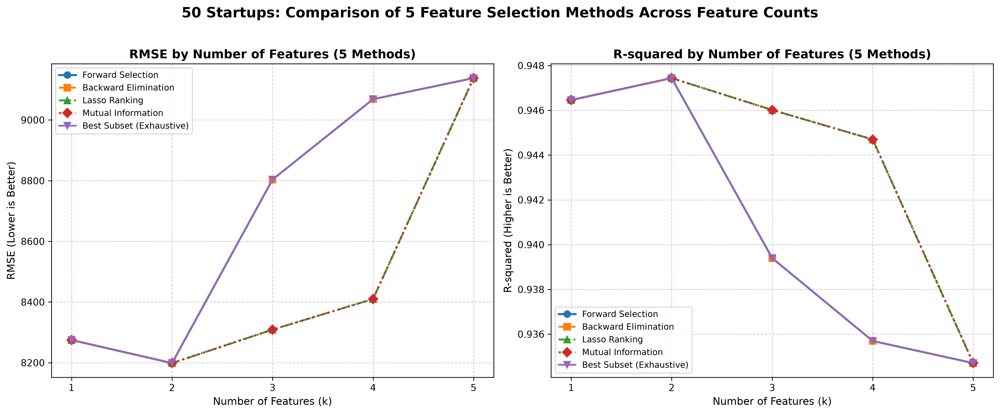

# 50 Startups: 多元線性迴歸與特徵選擇比較分析實驗室

[](https://www.python.org/downloads/)
[](LICENSE)
[](index.html)

本專案依據 **CRISP-DM** 規範，針對 `50_Startups` 資料集進行深入的資料探索、特徵工程、多元線性迴歸建模，以及 **5 種特徵選擇方法**（Forward Selection、Backward Elimination、Lasso Regularization、Mutual Information、Best Subset Selection）在特徵維度 $k = 1 \dots 5$ 下的性能比較，並建置了**現代化暗黑毛玻璃互動式儀表板與新創獲利即時預測模擬器**。

---

## 📊 五條折線評估圖表 (RMSE & R² by Number of Features)



### 核心發現
1. **全域最優組合 ($k = 2$)**：
   - 所有 5 種方法在 $k=2$ 時一致選取 `R&D Spend`（研發支出）與 `Marketing Spend`（行銷支出）。
   - 在此維度下，模型達到全域最佳泛化能力：**測試集最低 RMSE 為 $8,198.80**，**測試集最高 R² 達 0.9474**。
2. **中段特徵選擇路徑分歧 ($k = 3 \sim 4$)**：
   - **Lasso** 與 **Mutual Information** 優先納入州別虛擬變數（`State_New York`、`State_Florida`），保持較佳的泛化誤差（RMSE 約 8,309 ~ 8,410）。
   - **Forward**、**Backward** 與 **Best Subset (RSS)** 優先納入 `Administration`（行政支出），導致測試集誤差回升較顯著。
3. **過度擬合收斂 ($k = 5$)**：
   - 納入全部 5 個變數時，測試集 RMSE 上升至 $9,137.99$，證實精簡特徵優於盲目納入全部變數。

---

## 📈 評估指標對照總表

| 特徵選擇方法 (Method) | 特徵數 ($k$) | 測試集 RMSE | 判定係數 R² | 選取之特徵組合 (Selected Features) |
| :--- | :---: | :---: | :---: | :--- |
| **Forward Selection** | 1 | 8,274.87 | 0.9465 | `R&D Spend` |
| **Forward Selection** | **2 ⭐** | **8,198.80** | **0.9474** | `R&D Spend, Marketing Spend` |
| Forward Selection | 3 | 8,803.78 | 0.9394 | `R&D Spend, Marketing Spend, Administration` |
| Forward Selection | 4 | 9,068.54 | 0.9357 | `R&D Spend, Marketing Spend, Administration, State_Florida` |
| Forward Selection | 5 | 9,137.99 | 0.9347 | `All 5 Features` |
| **Backward Elimination** | 1 | 8,274.87 | 0.9465 | `R&D Spend` |
| **Backward Elimination** | **2 ⭐** | **8,198.80** | **0.9474** | `R&D Spend, Marketing Spend` |
| Backward Elimination | 3 | 8,803.78 | 0.9394 | `R&D Spend, Administration, Marketing Spend` |
| Backward Elimination | 4 | 9,068.54 | 0.9357 | `R&D Spend, Administration, Marketing Spend, State_Florida` |
| Backward Elimination | 5 | 9,137.99 | 0.9347 | `All 5 Features` |
| **Lasso Ranking** | 1 | 8,274.87 | 0.9465 | `R&D Spend` |
| **Lasso Ranking** | **2 ⭐** | **8,198.80** | **0.9474** | `R&D Spend, Marketing Spend` |
| Lasso Ranking | 3 | 8,309.06 | 0.9460 | `R&D Spend, Marketing Spend, State_New York` |
| Lasso Ranking | 4 | 8,409.92 | 0.9447 | `R&D Spend, Marketing Spend, State_New York, State_Florida` |
| Lasso Ranking | 5 | 9,137.99 | 0.9347 | `All 5 Features` |
| **Mutual Information** | 1 | 8,274.87 | 0.9465 | `R&D Spend` |
| **Mutual Information** | **2 ⭐** | **8,198.80** | **0.9474** | `R&D Spend, Marketing Spend` |
| Mutual Information | 3 | 8,309.06 | 0.9460 | `R&D Spend, Marketing Spend, State_New York` |
| Mutual Information | 4 | 8,409.92 | 0.9447 | `R&D Spend, Marketing Spend, State_New York, State_Florida` |
| Mutual Information | 5 | 9,137.99 | 0.9347 | `All 5 Features` |
| **Best Subset (Exhaustive)** | 1 | 8,274.87 | 0.9465 | `R&D Spend` |
| **Best Subset (Exhaustive)** | **2 ⭐** | **8,198.80** | **0.9474** | `R&D Spend, Marketing Spend` |
| Best Subset (Exhaustive) | 3 | 8,803.78 | 0.9394 | `R&D Spend, Administration, Marketing Spend` |
| Best Subset (Exhaustive) | 4 | 9,068.54 | 0.9357 | `R&D Spend, Administration, Marketing Spend, State_Florida` |
| Best Subset (Exhaustive) | 5 | 9,137.99 | 0.9347 | `All 5 Features` |

---

## 🌐 互動式 Web 儀表板與獲利模擬器

本專案包含零外部後端依賴的純前端互動式儀表板：
- **5 條折線互動圖表**：支援動態切換各方法、自訂 Tooltips。
- **$k$-Inspector 檢視滑桿**：拖曳特徵數滑桿，即刻剖析 5 種方法選出的特徵集合標籤。
- **即時獲利模擬器 (Deployment Sandbox)**：隨意調整研發、行銷、行政支出與州別，微秒級呈現預估獲利與各維度貢獻度長條圖。
- **50 Startups 資料集檢視器**：支援模糊搜尋與欄位預覽。

---

## 🛠️ 安裝與執行方式

### 1. 安裝 Python 依賴套件
```bash
pip install -r requirements.txt
```

### 2. 執行模型訓練與特徵選擇評估
```bash
python main.py
```

### 3. 啟動互動式網頁儀表板
```bash
# 啟動本機伺服器
python -m http.server 8080

# 於瀏覽器開啟
# http://localhost:8080/
```
*(或直接雙擊 `index.html` 即可於任意現代瀏覽器離線執行)*

---

## 📁 專案檔案清單

- `main.py`：CRISP-DM 流程之完整機器學習與特徵選擇腳本
- `50_Startups.csv`：原始新創支出與利潤資料集
- `requirements.txt`：Python 依賴項目清單
- `index.html`：互動式儀表板頁面
- `style.css`：現代暗黑毛玻璃設計樣式表
- `app.js`：圖表聯動與即時預測模擬運算邏輯
- `data.js`：內嵌完整實驗數據與迴歸方程式係數
- `five_methods_comparison.png`：5 種方法特徵數比較圖
- `feature_selection_comparison.png`：基準向前選取路徑圖
